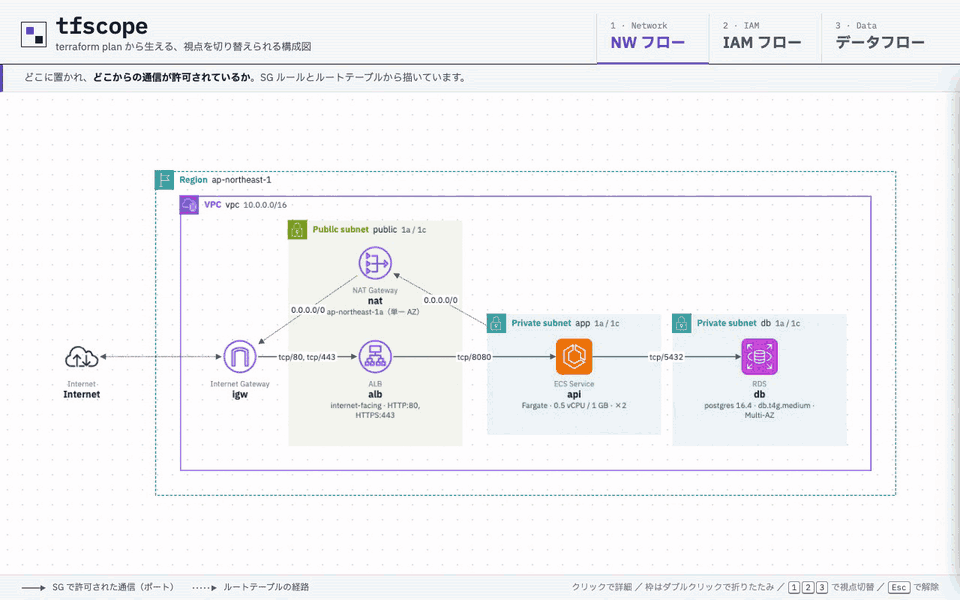
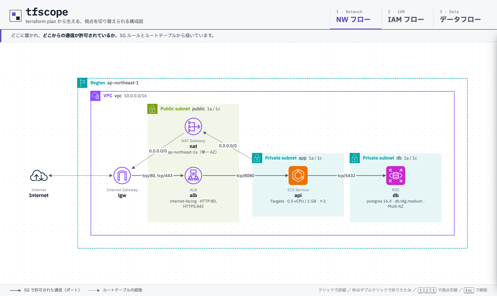
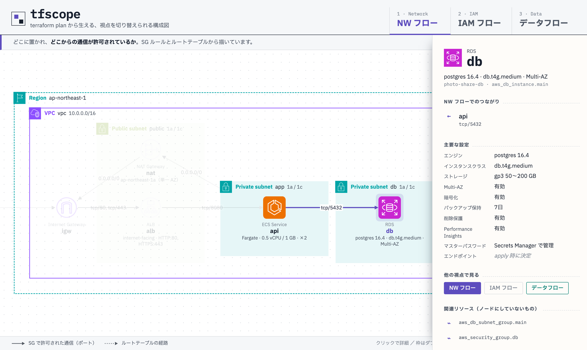
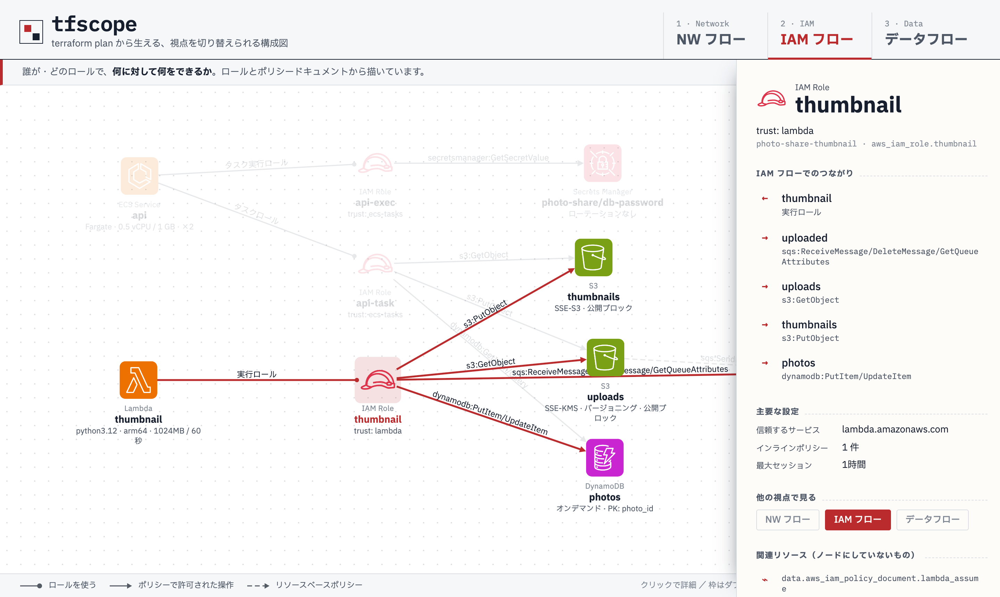
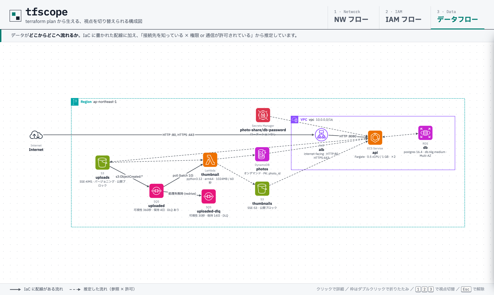
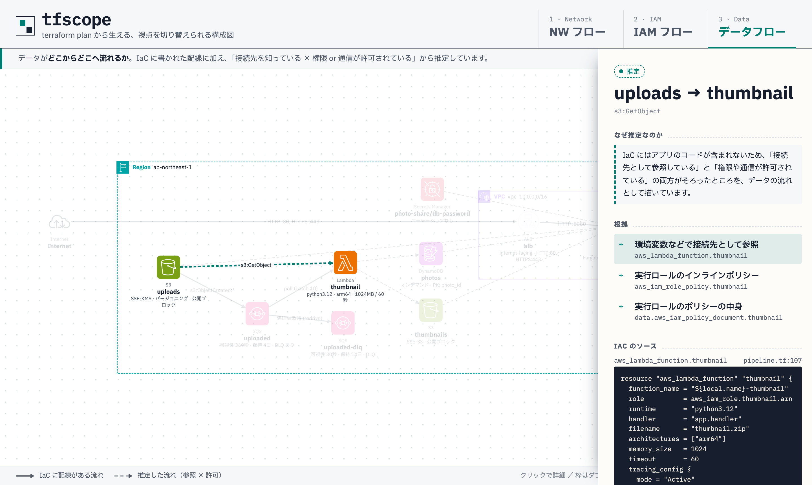
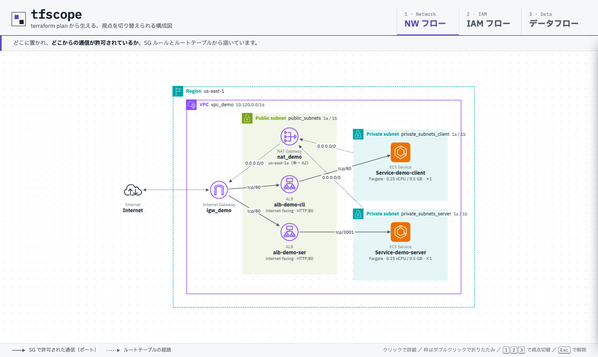
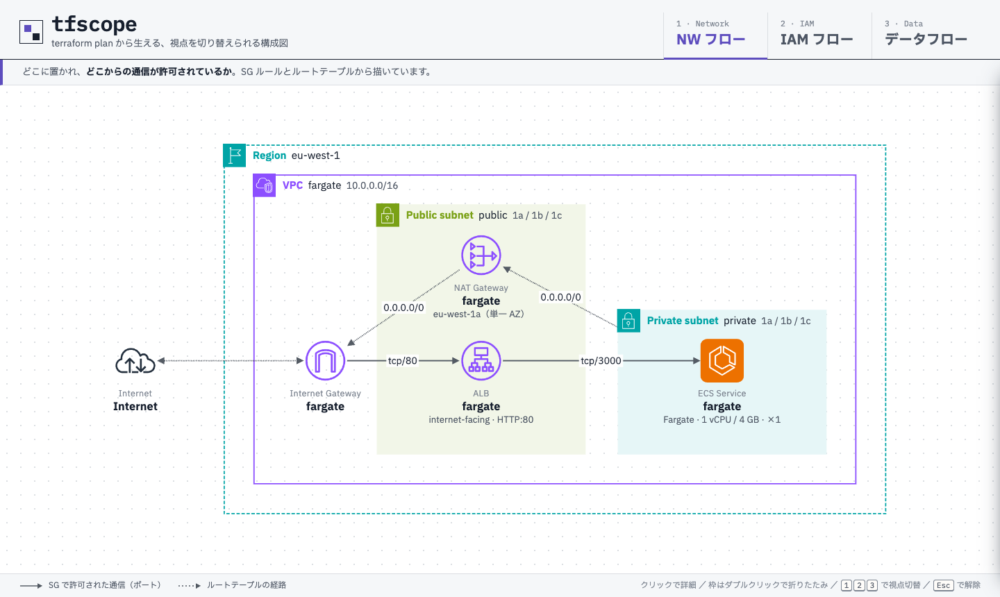
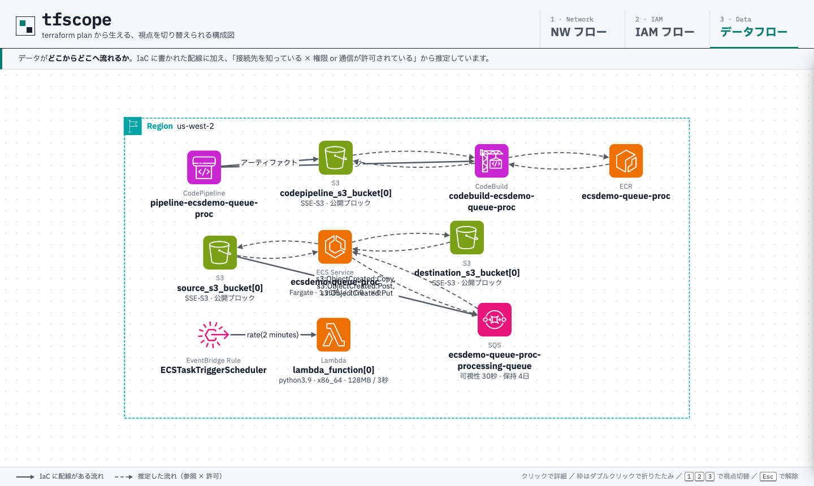

# terraform plan から「視点を切り替えられるAWS構成図」を生成してみた

## 概要

AWS構成図を、Terraformの`terraform plan`の結果から自動生成し、
**NWフロー / IAMフロー / データフロー** の3つの視点を切り替えて見られるビューアを試作しました。



- アイコンや枠（Region / VPC / サブネット）は AWS Architecture Icons の表記に合わせています
- 各リソースの下に、インスタンスクラスや Multi-AZ などの主要な設定値を出しています
- ノードをクリックすると詳細パネルが開き、設定値の一覧と、根拠になったIaCのコードが見られます
- 選択したまま視点を切り替えると、同じリソースを別の視点で追いかけられます
- VPCやサブネットはダブルクリックで折りたたみ・展開できます
- 公開されている Terraform のサンプル8つ（terraform-aws-modules や AWS のサーバーレスパターン、フルスタックの ECS アプリなど）で、「出てほしい線」がすべて出て、「出てはいけない線」が出ないことを確かめています

ソースは [develop/](develop/) に置いています。

動作環境: Terraform 1.5.7 / hashicorp/aws 5.x・6.x / moto 5（検証用の AWS モック） / Node.js 22 / Cytoscape.js 3.34 + ELK / AWS Architecture Icons（2026年1月30日版）

## 経緯

業務でAWS構成図を見たり描いたりする機会は多いのですが、世にある構成図の描き方が、個人的にはどうにも使いにくいと感じていました。
理由はだいたい次の3つです。

1. **すぐ実装とずれる**
   手で描いた図は、描いた瞬間から古くなり始めます。SGを1つ足しても、図まで直す人はあまりいません。
2. **1枚に全部を詰め込む**
   ネットワークの配置も、IAMの権限も、データの流れも、同じ1枚に描こうとするので、線が増えるほど何も読めなくなります。
3. **見たいものが人によって違う**
   NW担当は「どこからどこへ通信できるか」、セキュリティ担当は「誰が何をできるか」、アプリ担当は「データがどこを通るか」を知りたいのに、図は1種類しかありません。

そこで、自分が思う「理想の構成図」を次のように置いてみました。

- **実装に追従する**（IaCから生成できる）
- **見たい内容によって視点を切り替えられる**（データフロー、NWフロー、IAMフロー等）
- **ペラ1枚ではなく、動的に見やすさを追求する**（クリックで詳細が開く、折りたたむ等）

構成図を「1枚の絵」ではなく「1つのモデル＋複数のビュー」として扱う、という考え方です。

### 既存のツールについて

近いことをしているツールはすでにいくつかあります。私が調べた範囲での印象は以下のとおりです。

| ツール | 近い点 | 足りないと感じた点 |
|--|--|--|
| Ilograph | 視点（perspective）の切り替え、クリックでの深掘り | 図の定義は手書きで、IaCに追従しない |
| IcePanel / Structurizr（C4モデル） | ズームレベルとモデル/ビューの分離 | IaCから生成しない。AWS固有のNWやIAMは表現しづらい |
| Cloudcraft / Hava 等 | 実環境から自動生成する | 基本は1枚の絵で、視点の切り替えが弱い |
| InfraMap / `terraform graph` | IaCから生成する | リソースの依存グラフで、人が読む図ではない |

3つを全部満たすものは見当たらなかったので、プロトタイプを作ってみることにしました。

## 完成品紹介

サンプルとして「画像投稿サービス」を想定したTerraformを用意しました。
ALB → ECS → RDS の同期処理と、S3 → SQS → Lambda → DynamoDB のサムネイル生成処理がある、よくある構成です。

### NWフロー

「どこに置かれていて、どこからの通信が許可されているか」を描きます。

- リソースはサブネットの`Tier`タグ（public / app / db）ごとの枠にまとめています
- 枠がパブリックかプライベートかは、IGWへのルートがあるかどうかで判定しています
- 実線の矢印はSGルールで許可された通信です。`0.0.0.0/0`からの許可は、実際の経路どおりIGWから入ってくる線にしています
- 点線はルートテーブルの経路です（app → NAT → IGW の外向きの通信）



リソースをクリックすると、右から詳細パネルが開きます。
「主要な設定」には、本体の属性だけでなく関連リソース（RDSならサブネットグループ、ECSならタスク定義やターゲットグループ）の値もまとめています。



エンドポイントのように、apply するまで決まらない値は「apply 時に決定」と表示しています。

### IAMフロー

「誰が、どのロールで、何に対して何をできるか」を描きます。
ロールをクリックすると、そのロールの権限だけが浮かび上がります。



S3 → SQS の矢印は、SQSのキューポリシー（リソースベースポリシー）の`aws:SourceArn`条件から引いています。

### データフロー

「データがどこからどこへ流れるか」を描きます。
実線はIaCに配線が書かれているもの、点線は推定したものです（推定の仕方は後述します）。
VPCの中のリソースはVPCの枠に、S3やSQSなどのマネージドサービスはRegionの枠に入れています。
推定した線は数が多くラベルが重なるので、ノードを選んだときだけラベルを出すようにしています。



点線の矢印をクリックすると、なぜその流れを推定したのかと、根拠になったIaCのコードが表示されます。



## 仕組み

```
terraform plan → terraform show -json → tf2model（変換） → model.json → ビューア（Cytoscape.js）
```

### plan JSON の「configuration」を使う

`terraform show -json` の出力には、大きく分けて`planned_values`（plan時点の値）と`configuration`（書いた設定そのもの）があります。

plan時点ではARNやIDがまだ決まっていない（unknown）ので、`planned_values`だけではリソース同士の関係が分かりません。
一方`configuration`には、各属性が**どのリソースを参照しているか**が残っています。

```json
"statement": [
  {
    "actions":   { "constant_value": ["s3:PutObject"] },
    "resources": { "references": ["aws_s3_bucket.uploads.arn", "aws_s3_bucket.uploads"] }
  }
]
```

`jsonencode()`の中で参照していても`references`には残るので、ECSのコンテナ定義の環境変数が何を指しているかも分かります。
今回は、この参照を辿って3つの視点を組み立てています。
AWSの認証情報はダミーにして、AWSのAPIを呼ばずにplanしています。

### 主要な設定値の集め方

`planned_values`には各リソースの属性が入っていますが、そのまま並べると`availability_zone_rebalancing`のような既定値ばかりになって、肝心の値が埋もれます。
そこで、リソースの種類ごとに「運用で見たい項目」を決めて、関連リソースからも集めるようにしました。

| リソース | 主な項目 | 集め方 |
|--|--|--|
| ECS サービス | CPU / メモリ、イメージ、環境変数、ヘルスチェック、ロールバック | タスク定義とターゲットグループを参照から辿る |
| ALB | スキーム、リスナー、TLSポリシー | ALBを参照しているリスナーを集める |
| RDS | エンジン、クラス、Multi-AZ、暗号化、バックアップ | 本体の属性 |
| S3 | 暗号化、バージョニング、公開ブロック | バケットを参照している設定系リソースを集める |
| SQS | 可視性タイムアウト、保持期間、DLQ | `redrive_policy`の参照先 |

ECSのコンテナ定義は、`jsonencode`の中でARNなどを参照しているため、plan時点では丸ごとunknownになります。
イメージや環境変数の名前は、この場合だけ`.tf`のソースから拾っています。

### 各視点の材料

| 視点 | IaCの中の材料 |
|--|--|
| NWフロー | サブネットを参照している属性（配置）、SGルール（通信）、ルートテーブル（経路、パブリック/プライベートの判定） |
| IAMフロー | ロールを使う側（Lambdaの`role`、ECSタスク定義の`task_role_arn`、RDS Proxyの`role_arn`など）、ロールのポリシー（インライン、アタッチ、AWS管理ポリシー）、リソースベースポリシー（Lambdaの実行許可、SQS / SNS / S3のポリシー） |
| データフロー | ALBのリスナー→ターゲットグループ、API Gatewayの統合、S3イベント通知、Event Source Mapping、EventBridgeのターゲット、SNSのサブスクリプション、RDS Proxyのターゲット、CodePipelineのステージ ＋ 推定 |

NWフローでは、SGルールの「参照元SG → 対象SG」を、それぞれのSGを付けているリソース同士の矢印に置き換えています。
SG同士の関係ではなく、「ALBからECSに8080で通信できる」という形で読めるようにするためです。

### データフローの推定

一番工夫したのがここです。
IaCにはアプリのコードが含まれないので、「ECSのアプリがDynamoDBを読んでいる」といったことは、本来IaCからは分かりません。

そこで、**IAMで特定のリソースへの読み書きが許可されていれば、データが流れうるとみなして線を引く**ことにしました。
「許可されていてアクセスできる状態」を描く、という割り切りです。`Resource: "*"`の権限は対象が特定できないので線にはせず、ロールの警告として出しています。

向きはIAMのactionの動詞から決めています。

| 操作 | 向き | 例 |
|--|--|--|
| `Get` / `Query` / `Receive`など | リソース → コンピュート | `s3:GetObject`なら S3 → Lambda |
| `Put` / `Update` / `Send` / `Invoke`など | コンピュート → リソース | `dynamodb:PutItem`なら Lambda → DynamoDB |
| `sqs:DeleteMessage` / `ChangeMessageVisibility` | リソース → コンピュート | 受け取ったメッセージの後処理なので、受信側として扱う |
| `GetQueueAttributes` / `ListBucket`など | 線にしない | 中身を読まないメタデータの取得 |

さらに、根拠の強さを2段階に分けて、詳細パネルに出しています。

- **参照あり**：環境変数などで、接続先としてそのリソースを参照している（値の突き合わせを含む）
- **IAMのみ**：許可はあるが、接続先として参照している根拠はない

IAMで制御しないRDSなどは、「接続先として参照している」かつ「SGで通信が許可されている」ところを、双方向の線にしています。

| 例 | 根拠 | 推定 |
|--|--|--|
| Lambda と S3(uploads) | 環境変数 `SOURCE_BUCKET` ＋ `s3:GetObject` | uploads → Lambda（参照あり） |
| ECS と DynamoDB | 環境変数 `PHOTOS_TABLE` ＋ `dynamodb:GetItem/Query` | DynamoDB → ECS（参照あり） |
| ECS と RDS | 環境変数 `DB_HOST` ＋ SG で tcp/5432 | ECS ⇄ RDS（向きは分からないので双方向） |

もちろん推定なので、図では点線にして、クリックすると根拠を確認できるようにしています。

## 公開サンプルで検証した

自分で書いたサンプルは、変換器が読める書き方にそろえてしまっています。
実際のコードで使えるかを確かめるため、公開されているTerraformのサンプルでも試しました。

| サンプル | 特徴 |
|--|--|
| [terraform-aws-modules/ecs](https://github.com/terraform-aws-modules/terraform-aws-ecs) `examples/fargate` | モジュールの入れ子、for_each、ALBのモジュール |
| [terraform-aws-modules/vpc](https://github.com/terraform-aws-modules/terraform-aws-vpc) `examples/complete` | countで作るサブネット、VPCエンドポイント |
| [aws-samples/serverless-patterns](https://github.com/aws-samples/serverless-patterns) 3つ | API Gateway → Lambda → DynamoDB、Lambda → RDS Proxy → Aurora、EventBridge → SNS → Lambda |
| [aws-ia/ecs-blueprints](https://github.com/aws-ia/ecs-blueprints) | 基盤とサービスでスタックを分けた構成、CI/CD |
| [aws-samples/amazon-ecs-fullstack-app-terraform](https://github.com/aws-samples/amazon-ecs-fullstack-app-terraform) | 自作モジュールを34回呼び出す、フロント/バックエンド＋CI/CD のアプリ（約100リソース） |

### 進め方

1. **AWSのモックに向けてplanする**
   データソース（`aws_caller_identity`など）はAWSのAPIを呼ぶので、[moto](https://github.com/getmoto/moto)（AWSのモック）に向けてplanしました。
   本物のAWSには絶対に出ないように、plan中だけ存在しないプロキシを`HTTPS_PROXY`に設定しています（古いプロバイダが`AWS_ENDPOINT_URL`を無視しても、通信が外に出ずに失敗します）。
2. **「正解の線」を手で書く**
   各サンプルのREADMEとコードを読み、「この構成図ならこの線は出ていてほしい」を84本、「この線は出てはいけない」を6本書きました。
3. **再現率を測りながら直す**
   出てほしい線のうち何本が図に出たかを測り、外れた線の原因を1つずつ潰しました。

### 結果

| | 最初 | 最後 |
|--|--|--|
| NWフロー | 82% | 100% |
| IAMフロー | 55% | 100% |
| データフロー | 33% | 100% |
| **全体** | **57%（36/63）** | **100%（90/90）** |

最初の数字は7サンプル・63本の時点のものです。自分のサンプルでは100%だったので、最初の57%は「サンプルに合わせて作っていただけ」ということです。
あとから足したフルスタックのサンプルも、追加した時点では44%で、対応後に100%になりました。







### 実際のコードに特有だった書き方

外れた線の原因は、ほとんどが「実際のコードの書き方」でした。

| 書き方 | 何が困るか | 対応 |
|--|--|--|
| モジュールの入れ子 | 参照が`var.x`や`module.m.out`の形で止まる | 呼び出し元の引数・子モジュールのoutputを辿って、最終的なリソースまで解決 |
| `locals` | plan JSONに`locals`の中身が無い | `.tf`のソースから`locals`を読む |
| `dynamic`ブロック | plan JSONに中身が一切出ない | ソースから`dynamic`ブロックの参照を読む |
| 設定のmap＋`for_each` | `each.value`が「どのキーの設定か」分からない | モジュール呼び出しのmapをキーごとに読み、インスタンスのキーに対応する分だけを使う |
| 文字列で書いたARN | `"arn:aws:dynamodb:*:*:table/${var.name}"`は参照ではない | planで確定したポリシーのJSONを読み、ARNのパターンをリソース名と突き合わせる |
| 変数での受け渡し | Lambdaの環境変数もテーブル名も`var.table`で、互いを参照していない | 環境変数の値（名前やURL）をリソース名と突き合わせる |
| 別リソースでの配線 | API Gatewayの統合、Lambdaの実行許可、SNSのサブスクリプションなど | 配線用のリソースを種類ごとに読む |
| SGの書き方の違い | `ingress`ブロック、CIDRでの許可、`"self"`の書き方 | それぞれ読み、CIDRはサブネット層やVPCに置き換える |
| 旧名のリソース | `aws_alb`（`aws_lb`の旧名）、`aws_default_route_table`、`main_route_table_id`での関連付け | 同じ種類として扱い、関連付けの無いサブネットはVPCのメインルートテーブルを使う |
| 共有ロール | 1つのロールをCodeBuild 2つとCodePipelineで共有している | どの権限をどれが使うか分からないので、データの置き場所への線だけ「共有ロール」として引き、ビルドやコンピュートへの線は参照の根拠があるときだけにする |

特に「参照ではなく値（名前）で突き合わせる」が効きました。
plan時点ではARNやIDは決まっていませんが、名前は決まっていることが多いので、名前を手がかりにできます。

### 機密値の扱い

plan JSONには、`sensitive`を指定した値やデータソースで読んだシークレットが平文で入ります。
図を共有したときに一緒に出ていかないよう、モデルを作る前に`sensitive_values`で指定された値を伏せ、コード片に直書きされた`password = "..."`のような値も伏せています。
検証では、motoに入れたダミーのシークレットがモデルに入っていないことを、テストで確かめています。

## 使い方

```sh
cd develop
npm install
npm run plan     # terraform plan → infra/plan.json（AWS の認証情報は不要）
npm run model    # plan.json → viewer/public/model.json
npm run dev      # http://localhost:5178
```

自分のTerraformで試す場合は、`terraform show -json <planファイル>`の出力と、planを取ったディレクトリを`tf2model/cli.mjs`に渡してください（ディレクトリは`terraform init`済みのものを渡すと、モジュールの中も読みます）。

```sh
node tf2model/cli.mjs path/to/plan.json path/to/tf-dir > viewer/public/model.json
```

公開サンプルでの検証を再現する場合は、motoを起動してから実行します。

```sh
MOTO_IAM_LOAD_MANAGED_POLICIES=true uvx --from 'moto[server]' moto_server -p 5055   # 別のターミナルで
npm run samples -- fetch    # サンプルを取得（コミットを固定）
npm run samples -- plan     # moto に向けて plan
npm run samples -- report   # 正解の線の再現率を表示
```

## 制約・課題

プロトタイプなので、割り切ったところが多いです。

- **スタックをまたぐ線は引けない**：別スタックのVPCやProxyを変数で受け取る作りだと、どのリソースかが分かりません（ecs-blueprintsやRDS Proxyのサンプルがこの形でした）
- **推定は「許可」まで**：IAMで許可されていても、アプリが実際に呼んでいるとは限りません
- **対応リソースは約40種類**：検証したサンプルに出てくるものと、その周辺です
- **HCLはきちんとパースしていない**：`locals`や`dynamic`ブロックは、括弧の対応と正規表現で読んでいます。凝った書き方では取りこぼすはずです
- **レイアウトが毎回変わる**：自動レイアウトなので、構成が変わると配置も変わります。差分を見比べるには向いていません
- **AZごとには描いていない**：サブネットは`Tier`タグ（無ければブロック名）でまとめて1つの枠にしているので、AWSの公式図によくある「AZごとの列」にはなっていません
- **IAMフローは線が交差しやすい**：ロールとリソースが多対多になるので、全体を眺めるより、ロールを選んで絞り込む使い方が向いています
- **正解の線は自分で書いた**：100%は、自分で書いた90本（出てほしい線84本、出てはいけない線6本）に対してのものです。それ以外の線が「余計でないか」は、目視で確認しました
- **バンドルが大きい**：ELK（レイアウトエンジン）が大きく、gzip後で約600KBあります

今後やってみたいのは次のあたりです。

- PRごとに図の差分を出す（「このPRでECSからDynamoDBへの書き込みが増えた」が分かる）
- 複数スタックのplanをまとめて1つの図にする（名前やタグでスタック間の対応を取る）
- 実環境（state）との突き合わせ

## まとめ

構成図を「1枚の絵」ではなく「モデル＋視点」として作ると、IaCから生成しても意外と読める図になる、という手応えがありました。

一方で、自分のサンプルでは100%でも、公開サンプルに当てると57%でした。
モジュール、`dynamic`、文字列のARN、変数での受け渡しなど、実際のコードの書き方に1つずつ対応していくと100%まで上がりましたが、「IaCから構成図を作る」の難しさの大半は、図の描き方ではなくコードの読み方にあると感じました。
