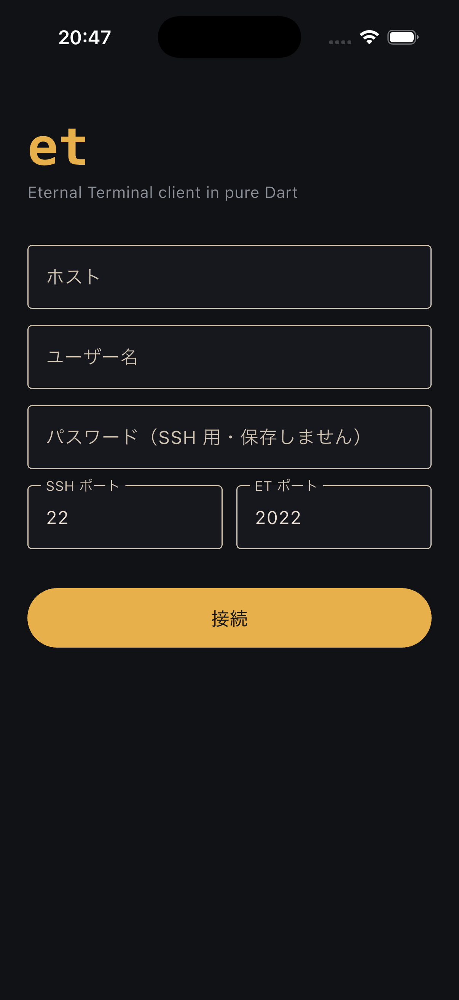
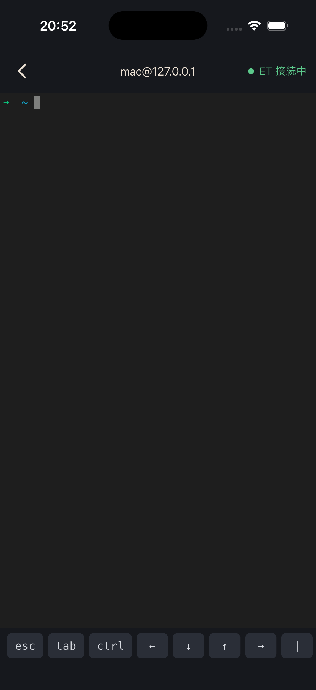

# iPhoneからMacにEternal Terminalで接続してみた（DartでETクライアントを自作）

## 概要

iPhoneからMacへ、SSHではなくEternal Terminal（以下ET）というプロトコルで接続してみました。
iOSのET対応クライアントは既存のものもありますが、今回はDartでETクライアントのライブラリを自作し、Flutterで簡単なiPhoneアプリにしています。

作ったライブラリはこちらで公開しています。
https://github.com/kodakamasaru/dart_et

画面ロックや機内モード、Wi-Fi⇔モバイル通信の切り替えを挟んでも、セッションが切れずに、途切れていた間の出力も欠けずに復帰するところまで確認できました。

動作環境: iPhone SE（第3世代）iOS 26.6 / macOS 26.7（Intel） / etserver 7.0.0 / Flutter 3.47.5 / Dart 3.13

## 経緯

iPhoneからMacに入るとき、普通のSSHだと画面ロックや電波の切り替えのたびに接続が切れてしまい、地味にストレスでした。
この問題を解決するプロトコルとしてはmoshが有名で、iOSアプリも、Flutter（Dart）向けのライブラリ[dart_mosh](https://pub.dev/packages/dart_mosh)も存在します。

一方で、moshとは違うアプローチで同じ問題を解決する、ETというプロトコルもあります。
こちらもiOSアプリ（Panicの[Prompt 3](https://panic.com/prompt/)）は対応済みなのですが、Dartのライブラリは見当たりませんでした。
dart_moshがあるなら参考にしてdart_etを実装できるのではと思い、自作してみました。

## ETとは

ETは「自動で再接続してくれるリモートシェル」です。
SSH、moshとの違いをざっくり表にするとこのようになります。

| | SSH | mosh | ET |
|--|--|--|--|
| 通信 | TCP（22番） | UDP（60000〜61000番） | TCP（2022番） |
| サーバ側に必要なもの | sshd | `mosh-server`（接続ごとにSSH経由で起動） | `etserver`（常駐）＋`etterminal`（接続ごとにSSH経由で起動） |
| 回線断・IPアドレスの変化 | × 切れる | 〇 | 〇 |
| 切れていた間の出力 | × | △ 最新の画面だけ届く | 〇 全部届く |
| スクロールバック | 〇 | × | 〇 |
| 打った文字の即時表示（ローカルエコー予測） | × | 〇 | × |
| ポートフォワード | 〇 | × | 〇 |

SSHは、回線が切れたらそこでセッションが終わりです。
moshとETは、どちらも最初の起動と認証にSSHを使い、そのあとは独自の通信に切り替えることで、回線が切れても繋がり続けるようにしています。

違いは復帰のしかたで、moshは「画面の状態」を同期するので、切れていた間の途中の出力は飛ばされ、スクロールして遡ることもできません。
ETは送ったバイト列を全部覚えておき、再接続したときに相手が受け取れていない分を再送するので、途中の出力も全部届きます。

逆に、回線が遅いときの打鍵の快適さはmoshの方が上です。

## 完成品紹介

接続画面です。
ホストとユーザー名、SSHのパスワードを入れて接続します。



接続すると、このようにターミナルが開きます。



## 使い方

### Mac側の準備

1. Homebrewでetをインストールし、etserverを起動します

```bash
brew install et
brew services start et
```

2. 「システム設定→一般→共有→リモートログイン」をオンにします（SSH用）

etserverはTCPの2022番ポートで待ち受けます。
同じWi-Fi内であれば、これだけでiPhoneからMacのIPアドレス（`192.168.x.x`など）宛てに繋がります。

3. 外出先からも繋ぐ場合は、MacとiPhoneに[Tailscale](https://tailscale.com/)を入れます

Tailscaleは、自分の端末同士をVPNで繋いでくれるサービスです。
MacとiPhoneの両方にアプリを入れて同じアカウントでログインするだけで、各端末に`100.x.y.z`というアドレスが割り当てられ、モバイル通信からでもそのアドレス宛てにMacへ届くようになります。
ルーターのポート開放などが不要なので、個人で使うには一番手軽だと思います（個人利用は無料で使えます）。

4. 必要に応じて、etserverのtelemetryをオフにします

telemetryは、etserverでエラーやクラッシュが起きたときに、その内容を匿名で開発元（DatadogとSentry）に送る機能です。
Homebrewで入れた場合、設定ファイルでデフォルトでオンになっているので、気になる方はオフにしておくとよいと思います。

```plaintext:/usr/local/etc/et.cfg
[Debug]
telemetry = false
```

※Apple Siliconの場合は`/opt/homebrew/etc/et.cfg`です。変更後は`brew services restart et`で反映されます。

### クライアント側

まずは、ライブラリに付属しているCLIのサンプルで、ETで繋がることを確認できます。
[Dart SDK](https://dart.dev/get-dart)が入っている環境で、以下を実行します。

```bash
git clone https://github.com/kodakamasaru/dart_et.git
cd dart_et
dart pub get
dart run example/et_cli.dart ユーザー名@MacのIPアドレス
```

※CLIのサンプルは、`etterminal`の起動にPCの`ssh`コマンドを使います。事前に`ssh ユーザー名@MacのIPアドレス`で普通にログインできることを確認しておいてください。

自分のアプリに組み込む場合は、`pubspec.yaml`にGitのURLで追加します（pub.devには公開していません）。

```yaml:pubspec.yaml
dependencies:
  dart_et:
    git:
      url: https://github.com/kodakamasaru/dart_et.git
```

今回のiPhoneアプリも、このライブラリを使って作っています（アプリ自体は公開していません。作りは「実装4」で紹介します）。

## ETの仕組み

ここでは、ETというプロトコル自体の仕組みを説明します（今回の実装に限らず、どの言語で作っても同じ内容です）。

公式サイトには大まかな説明しかなく、プロトコルの仕様書もありません（[要望のIssue](https://github.com/MisterTea/EternalTerminal/issues/452)は立っていますが、そのままになっています）。
そのため、C++のソースを読んで調べました。

### 接続の流れ

1. クライアントがSSHでサーバに入り、`etterminal`を起動する
2. `etterminal`がセッションIDと鍵（passkey）を発行して標準出力に表示するので、クライアントはそれを受け取ってSSHを切断する
3. クライアントはTCP 2022番で`etserver`に接続し、以降はETだけで通信する

SSHは「鍵を受け取るため」だけに使い、すぐ閉じているのがポイントです。
認証をSSHに任せているので、ET自体はパスワードや公開鍵の仕組みを持っていません。

1.で実行するコマンドは↓これだけです。

```bash
echo 'XXXabcdefghijklm/0123456789abcdefghijklmnopqrstuv_xterm-256color' | etterminal --verbose=0
```

`ID/passkey_TERM`の形式でランダムな値を渡すと、以下のような行が返ってきます。
サーバ側で採番し直した値が返ってくるので、こちらを使います。

```plaintext
IDPASSKEY:aB3dE5fG7hJ9kL1m/（32文字の英数字）
```

### 通信の暗号化

`etserver`に繋いだあとの通信は、すべて暗号化されています。
暗号化には、libsodiumという定番の暗号ライブラリの機能（`crypto_secretbox`）が使われていて、鍵はpasskeyの32文字をそのまま使います。

この方式では、鍵のほかに「nonce」という、暗号化のたびに毎回違う値にしなければいけない番号が必要です。
ETでは、nonceを通信には乗せず、送受信のたびにお互いが1ずつ数え上げる仕組みになっています。
さらに、番号の一部を「クライアント→サーバは`0`、サーバ→クライアントは`1`」と向きごとに固定しているので、同じ鍵を使っていても、行きと帰りで番号が被らないようになっています。

### 切れても復帰できる仕組み

ここがETの肝です。

1. 送信側は、送った暗号化済みのパケットを一定量（64MB）手元に残しておく
2. 再接続したら、お互いに「今までに何個受け取ったか」を送り合う
3. 相手が受け取れていない分を、手元に残しておいたパケットから再送する

再送するのは「一度暗号化したパケットそのもの」なので、nonceのカウンタがずれることもありません。

## 実装1: ライブラリの構成

コードの全体は[kodakamasaru/dart_et](https://github.com/kodakamasaru/dart_et)にあります。ここでは要点だけ抜粋して紹介します。
ライブラリの切り分けはdart_moshに合わせました。

* SSHと画面描画はアプリ側の責務とし、ライブラリは「起動コマンドの生成」「出力のパース」「通信」だけを持つ
* `MoshSshBootstrap`→`EtSshBootstrap`、`MoshServerConfig.parse`→`EtCredentials.parse`のように、APIの形を揃える
* protobufを`protoc`なしで手書きする（dart_moshの`ProtoWriter`/`ProtoReader`を流用し、bool・文字列・負の数を追加）

ただ、moshはUDPで状態を同期、ETはTCPで再送なので、中心の処理はまったくの別物になりました。

使う側からはこのようなイメージです。

```dart
// 1. SSHで etterminal を起動して鍵を受け取る（SSH部分はアプリ側）
final command = const EtSshBootstrap().command(EtCredentials.random());
final output = await sshClient.run(command);

// 2. ETで接続
final session = await EtSession.connect(
  host: '100.67.19.19',
  credentials: EtCredentials.parse(utf8.decode(output)),
);

session.stdout.listen(...);       // 出力
session.send(utf8.encode('ls\r')); // 入力
session.resize(80, 24);           // 画面サイズ
session.reconnect();              // アプリ復帰時などに即再接続
```

## 実装2: 暗号化

やりたいことは、「`etserver`と同じ方式で暗号化・復号できること」です。
`etserver`側の暗号化ライブラリ(libsodium)と同じ方式のDartライブラリ[pinenacl](https://pub.dev/packages/pinenacl)を使いました。

↓nonceを1ずつ数え上げる部分だけは、ETに合わせて自分で書いています。

```dart:et_cipher.dart
Uint8List encrypt(List<int> plaintext) {
  _incrementNonce(); // 暗号化する前に、番号を1つ進める

  // pinenaclの関数は、先頭に32バイトの0を付けたデータを受け取る決まりなので、付けてから渡す
  final padded = Uint8List(TweetNaCl.zerobytesLength + plaintext.length);
  padded.setRange(TweetNaCl.zerobytesLength, padded.length, plaintext);
  return TweetNaCl.crypto_secretbox(
      Uint8List(padded.length), padded, padded.length, _nonce, _key);
}

void _incrementNonce() {
  // 24バイトの番号を、先頭のバイトから繰り上がりつきで +1 する
  for (var i = 0; i < etNonceLength; i++) {
    _nonce[i] = (_nonce[i] + 1) & 0xff;
    if (_nonce[i] != 0) break; // 繰り上がりがなければ終了
  }
}
```

## 実装3: 再接続

ETの「受け取った数を送り合って、足りない分を再送する」部分です。
出てくる名前は、それぞれ以下のものです。

* `_reader` / `_writer`: 受信側・送信側の管理。受け取った数と、送ったパケットの控えを持っている
* `EtSequenceHeader`: 「今までに何個受け取ったか」を入れて送るメッセージ
* `EtCatchupBuffer`: 再送するパケットをまとめて送るメッセージ
* `frameProto` / `readProto`: メッセージに長さを付けて送る・受け取る処理

↓は、エラー処理などを省いた抜粋です（全体は`lib/src/transport/connection.dart`）。

```dart:connection.dart
// 自分が受け取った数を送る
link.add(frameProto(
  EtSequenceHeader(sequenceNumber: _reader.sequenceNumber).encode(),
));
// 相手が受け取った数を受け取る
final remote = EtSequenceHeader.decode(await readProto(queue));
// 相手が持っていない分を手元のバックアップから取り出す
final local = _writer.recover(remote.sequenceNumber);
// 相手の再送分を受け取ってから、自分の再送分を送る
final catchup = EtCatchupBuffer.decode(
  await readProto(queue, maxLength: etMaxMessageLength),
);
link.add(frameProto(EtCatchupBuffer(local).encode()));
```

## 実装4: iPhoneアプリ

アプリはFlutterで作り、SSHに[dartssh2](https://pub.dev/packages/dartssh2)、画面描画に[xterm](https://pub.dev/packages/xterm)を使っています。
ETの仕様とは関係なく、アプリとして入れた工夫は以下です。

* アプリがフォアグラウンドに戻ったら、すぐに`session.reconnect()`で繋ぎ直す（iOSはバックグラウンドで通信を止めるため、死んだ接続の検知を待たずに張り直す）
* iOSのキーボードにない`esc` `tab` `ctrl`や矢印キー、ペーストをツールバーで補う
* 接続先のホスト鍵を初回に確認して保存し、変わっていたら接続しない
* SSHのパスワードは保存しない

## 実機で試してみた

1秒ごとに番号を出力するループを流しながら、いろいろな方法で回線を切ってみました。

```bash
for i in $(seq 1 300); do echo $i; sleep 1; done
```

| 操作 | 結果 | etserverのログ |
|--|--|--|
| 画面ロック→解除 | 〇 | 再接続 |
| 機内モード15秒→解除 | 〇 | `Recovering 13 Messages` |
| Wi-Fiオフ（モバイル通信に切り替え） | 〇 | `Recovering 19 Messages` |
| モバイル通信で画面ロック約2分半→解除 | 〇 | `Recovering 151 Messages` |

どれも番号が抜けることなく続きました。
最後のケースでは、切れていた約2分半の出力151行分が、再接続した瞬間にまとめて流れてきます。

Wi-Fi⇔モバイル通信の切り替えは、Tailscale経由（`100.x.y.z`宛て）で試しています。
モバイル通信からは家のWi-Fi内のアドレス（`192.168.x.x`）には届かないので、Tailscaleなしだと切り替えた瞬間に繋ぎ先がなくなってしまうためです。

なお、Tailscaleを使うと、回線が変わってもトンネルの中のIPアドレスは変わらないので、短い切り替えであれば普通のSSHでも耐えることがあります。
ETが本領を発揮するのは、画面ロックやアプリのバックグラウンド化のように、TCPの接続自体が死んでしまう場面の方だと思います。

## 躓いたポイント

前半の3つはETそのものに由来するもの、後半の3つはMacやiPhoneの環境に由来するものです。

### masterのソースを読んで実装したら、リリース版と話が合わない

最初はGitHubのmasterブランチのソースを読んで実装していたのですが、masterには未リリースの変更がかなり入っていました。
接続時のチャレンジ認証（鍵を持っていることをBLAKE2bのハッシュで証明する）や、シェル終了時の終了コード通知などがそうで、Homebrewやaptで入る7.0.0には入っていません。

リリースタグ`et-v7.0.0`の`.proto`と見比べて、両方に対応させました。
サーバがチャレンジを送ってきたら新方式、送ってこなければ旧方式で接続します。

### etserverがまるごと落ちる

終了時に、masterで追加された`TERMINAL_CLOSE`というパケットを送るようにしていたのですが、これを7.0.0のetserverに送ったところ、etserverのプロセスごと落ちてしまいました。
7.0.0は知らない種類のパケットを受け取ると、ログに`Unknown packet type: 11`を出して強制終了する作りのようです。

1つのクライアントのせいで、同じサーバに繋いでいる全員のセッションが落ちるのはなかなか怖いですね。
（正しいpasskeyが必要なので、誰でも落とせるわけではありません。masterでは、接続を切るだけの処理に修正されています。）

対策として、`TERMINAL_CLOSE`はチャレンジ認証を使うサーバ（＝7.0.0より新しいサーバ）にだけ送るようにしました。

### 長さの表現が2種類ある

同じTCP接続の中で、メッセージの長さの表し方が2種類混ざっています。

* 接続時のやり取り: 8バイトの整数（リトルエンディアン）＋本体
* 接続後のパケット: 4バイトの整数（ビッグエンディアン）＋本体

最初は全部同じ形式だと思い込んでいて、接続直後の応答がまったく読めませんでした。
どうやら前者はC++のint64をそのままメモリの並びで書き出しているだけのようで、読み分けるようにしたところ読めるようになりました。

### MacのSSH経由だと`etterminal`が見つからない

ターミナルからは普通に`etterminal`が使えるので、最初はなぜ見つからないのかわかりませんでした。
どうやらMacのsshdがコマンドを実行するときの`PATH`は`/usr/bin:/bin:/usr/sbin:/sbin`だけのようで、Homebrewで入れたコマンドは見えていなかった模様。
起動コマンドの前に`PATH="$PATH:/opt/homebrew/bin:/usr/local/bin"; export PATH;`を付けて解決しています。

### iPhone実機だけ「No route to host」になる

シミュレータでは繋がるのに、実機だとLAN内のMac（`192.168.x.x`）に繋ぐと`No route to host`になりました。
原因はiOSの「ローカルネットワーク」の許可で、`Info.plist`に`NSLocalNetworkUsageDescription`（利用目的の文言）を書いておかないと、許可ダイアログすら出ずに拒否されるようです。

```xml:Info.plist
<key>NSLocalNetworkUsageDescription</key>
<string>同じネットワーク上の Mac に SSH / Eternal Terminal で接続するために使います。</string>
```

私の場合は、シミュレータでは`127.0.0.1`に繋いでいたので、実機に入れるまでまったく気づきませんでした。

### iPhoneのキーボードでバックスペースが効かない

iOSのソフトキーボードは、入力欄が空のときにバックスペースを押しても、アプリに何も通知しないようです。
xterm.dartの`TerminalView`には、これを検出するための`deleteDetection`というオプションがあり、`true`にすることで解決しました。

```dart
TerminalView(
  terminal,
  deleteDetection: true, // デフォルトは false
)
```

ドキュメントにも「モバイルでは推奨」と書いてあるので、デフォルトで`true`でもよい気がしますが。。。

## 今後の課題

* ポートフォワードへの対応
* SSHの公開鍵認証への対応
* 接続先を複数保存できるように
* pub.devへの公開

## 参考

* [Eternal Terminal](https://eternalterminal.dev/)
* [How Eternal Terminal Works](https://eternalterminal.dev/howitworks/)
* [MisterTea/EternalTerminal](https://github.com/MisterTea/EternalTerminal)
* [dart_mosh](https://pub.dev/packages/dart_mosh)
* [tphakala/et-go](https://github.com/tphakala/et-go)（Goの移植実装。読みやすく参考になりました）
* [pinenacl](https://pub.dev/packages/pinenacl) / [dartssh2](https://pub.dev/packages/dartssh2) / [xterm](https://pub.dev/packages/xterm)

最後まで読んでいただきありがとうございます。
