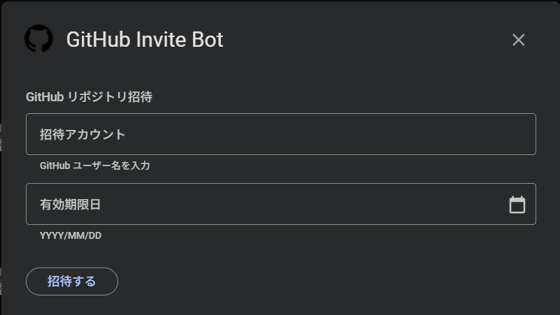

## 概要

GitHubでリポジトリにメンバーを招待する際、「〇月〇日まで」のように有効期限を設定したいことがあります。
しかし、GitHubの公式機能には「有効期限付き招待」が存在せず、
招待承諾したら手動で削除するまでアクセスし続けられる仕様です。<br/>
今回は、Google Apps Script（GAS）+ GitHub API + スプレッドシートの組み合わせで、有効期限付きの招待と自動削除を実現する仕組みを作ってみました。

## 完成品紹介

Google Chatでスラッシュコマンドを打つと、招待ダイアログが表示されます。



GitHubユーザー名、有効期限日を入力して「招待する」ボタンを押すと、GitHub APIを通じてコラボレーター招待が送られます。
有効期限が過ぎると日次のトリガーで自動的にアクセス権が削除されます。

## 全体構成

```
Google Chat                GAS Trigger
     |                         |
     | 招待コマンド             | 日次期限切れチェック
     v                         v
    +---------------------------+
    |            GAS            |
    +---+-----------------+-----+
        |                 |
        v                 v
  Spreadsheet           GitHub
  (データ管理)     (コラボレーター追加/削除)
```

## 実装

### 招待の流れ

招待時は、GitHub APIの [Add a repository collaborator](https://docs.github.com/en/rest/collaborators/collaborators#add-a-repository-collaborator) を使ってコラボレーターを追加します。

```javascript:.gs
// GitHub APIの共通リクエスト関数
function githubRequest_(tokenKey, method, path, payload) {
  var options = {
    method: method,
    headers: {
      'Authorization': 'Bearer ' + getConfig_(tokenKey), // Script Propertiesに設定したPAT
      'Accept': 'application/vnd.github+json',
      'X-GitHub-Api-Version': '2022-11-28',
    },
    muteHttpExceptions: true,
  };
  if (payload) {
    options.contentType = 'application/json';
    options.payload = JSON.stringify(payload);
  }
  var res = UrlFetchApp.fetch('https://api.github.com' + path, options);
  var code = res.getResponseCode();
  if (code >= 400) {
    throw new Error('GitHub API ' + method + ' ' + path + ' failed (' + code + ')');
  }
  return res.getContentText() ? JSON.parse(res.getContentText()) : null;
}

// ↑を使ってコラボレーターを追加する関数
function githubAddCollaborator(tokenKey, org, repo, username) {
  githubRequest_(tokenKey, 'put', '/repos/' + org + '/' + repo + '/collaborators/' + username, {
    permission: 'pull',
  });
}
```

招待が成功したら、誰をいつまで招待したかをスプレッドシートに記録します。

```javascript:.gs
function addPermission(record) {
  var lock = LockService.getScriptLock();
  lock.tryLock(10000);
  try {
    var sheet = getPermissionSheet_();
    sheet.appendRow([
      record.githubUsername,
      JSON.stringify(record.repoNames),
      Utilities.formatDate(record.expiresAt, Session.getScriptTimeZone(), 'yyyy/MM/dd'),
      Utilities.formatDate(new Date(), Session.getScriptTimeZone(), 'yyyy/MM/dd'),
    ]);
  } finally {
    lock.releaseLock();
  }
}
```

スプレッドシートの構成はシンプルで、1行1招待です。

| github_username | repo_names | expires_at | invited_at |
|--|--|--|--|
| octocat | ["repo-a","repo-b"] | 2026/06/01 | 2026/05/08 |

### 自動削除の流れ

GASの時間ベーストリガーで日次チェックを回しています。
スプレッドシートの全レコードを走査して、`expires_at`が今日より前のものを期限切れとして処理します。<br/>
削除時にひとつ考慮が必要なのは、招待を送ったけどまだ相手が承諾していないケースです。<br/>
承諾済みであれば [コラボレーター削除API](https://docs.github.com/en/rest/collaborators/collaborators#remove-a-repository-collaborator) で消せますが、未承諾の場合はコラボレーターとしてまだ存在しないため、[招待キャンセルAPI](https://docs.github.com/en/rest/collaborators/invitations) を使う必要があります。

```javascript:.gs
/**
 * リポジトリからコラボレーターを削除
 */
function githubRemoveCollaborator(tokenKey, org, repo, username) {
  githubRequest_(tokenKey, 'delete', '/repos/' + org + '/' + repo + '/collaborators/' + username);
}

/**
 * リポジトリの招待一覧を取得する
 */
function githubListInvitations(tokenKey, org, repo) {
  return githubRequest_(tokenKey, 'get', '/repos/' + org + '/' + repo + '/invitations') || [];
}

/**
 * 招待IDを指定してキャンセルする
 */
function githubDeleteInvitation(tokenKey, org, repo, invitationId) {
  githubRequest_(tokenKey, 'delete', '/repos/' + org + '/' + repo + '/invitations/' + invitationId);
}
```

```javascript:.gs
expired.forEach(function(record) {
  record.repoNames.forEach(function(repo) {
    // 招待中ならキャンセル、承諾済みならコラボレーター削除
    var invitations = githubListInvitations(tokenKey, org, repo);

    var invitation;
    for (var i = 0; i < invitations.length; i++) {
      if (invitations[i].invitee && invitations[i].invitee.login === record.githubUsername) {
        invitation = invitations[i];
        break;
      }
    }
    if (invitation) {
      githubDeleteInvitation(tokenKey, org, repo, invitation.id);
    } else {
      githubRemoveCollaborator(tokenKey, org, repo, record.githubUsername);
    }
  });
});
```

解除が成功したら、スプレッドシートからもデータを削除します。

```javascript:.gs
function deletePermissionRows(rowIndices) {
  if (rowIndices.length === 0) return;
  var lock = LockService.getScriptLock();
  lock.tryLock(10000);
  try {
    var sheet = getPermissionSheet_();
    var sorted = rowIndices.slice().sort(function(a, b) { return b - a; });
    sorted.forEach(function(row) { sheet.deleteRow(row); });
  } finally {
    lock.releaseLock();
  }
}
```

## Google Chatとの連携

Google ChatとGASの連携部分（スラッシュコマンドの登録、カードUIの構築など）については、
[こちらの記事](https://www.nxted.co.jp/blog/blog_detail?id=195)で解説しています。<br/>
ユーザー名や対象リポジトリ等、必要に応じて入力欄を設けます。
GitHub APIを実行すれば、Organization内のTeamを一覧表示して、招待対象のチームを選択するといったことも可能です。  

## まとめ

今回はGitHubの期限付き招待の仕組みを実装してみました。
Google Chatと連動させたかったので、
Google Chat(起動)+Google Apps Script(API, バッチ)+スプレッドシート(DB)
の構成としましたが、どの部分についても別サービスに置き換え可能かと思います。
導入する場合は運用しやすいようにカスタムしてみてください。
例: Slack(起動)+Cloudflare Workers(API, バッチ)+Cloudflare D1(DB)<br/>

最後まで読んでいただきありがとうございます。

## 参考

- [GitHub REST API - Collaborators](https://docs.github.com/en/rest/collaborators/collaborators)
- [GitHub REST API - Repository Invitations](https://docs.github.com/en/rest/collaborators/invitations)
