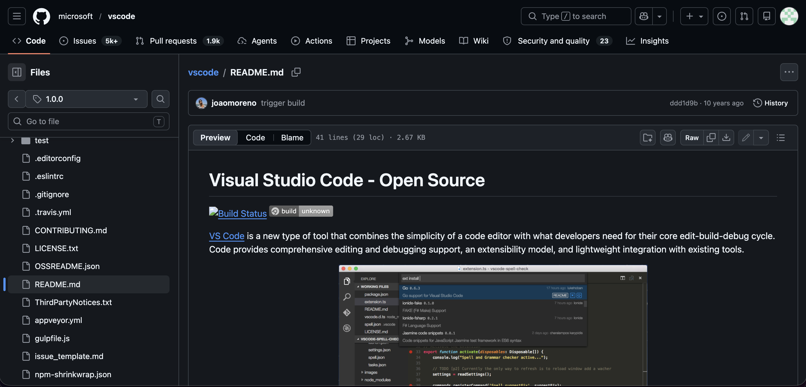
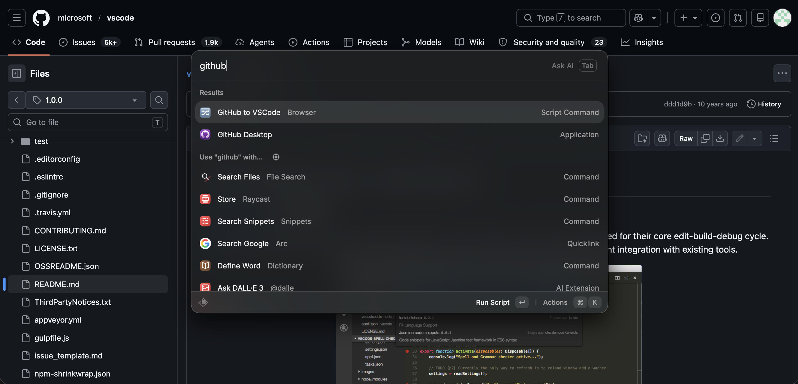
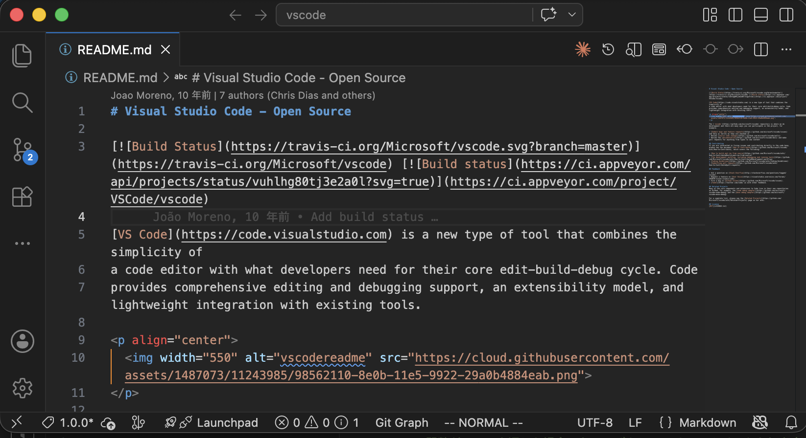
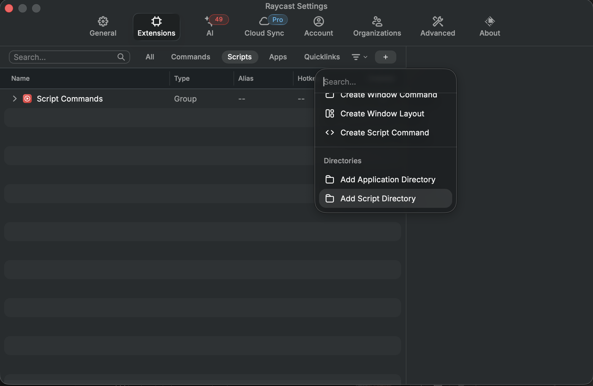

# Raycastでブラウザとローカルツールを連携してみる

## はじめに

最近、ランチャーアプリ[Raycast](https://www.raycast.com/)を使い始めたのですが、AppleScriptと組み合わせると想像以上の柔軟性で驚きました。

ショートカットキーをトリガーに、ブラウザにJavaScriptを注入することができますし、さらにその結果をローカルの別のアプリに橋渡しすることもできます。
別のアプリというところが重要で、これまでは1つのアプリ内に収まる効率化（Chrome拡張機能等）を考えることが多かったのが、その縛りなくアイディアを考えられるようになりました。
今回は、ブラウザ<=>VSCodeの繋ぎこみをしてくれるコマンドをお試しで作りましたのでご紹介します。
Raycast活用アイディアの参考になれば嬉しいです。

本記事の動作環境(筆者環境): macOS / Raycast / Google Chrome / iTerm2 / ghq(リポジトリ管理)

なお、Raycast自体はWindows版も存在しますが、本記事のスクリプトはAppleScript(`osascript`)に依存しているので、そのままではWindowsでは動作しません。
Windowsで同等のことをする場合は、PowerShellやAutoHotkeyを使った似た構成が組めるかと思います。

## 内容

今回作成したスクリプトは、Chromeで現在開いてるGitHubページをVSCodeで開くというものです。
CloneやCheckoutも必要に応じて自動で行うようにしています。
また、表示していたのがファイルページだった場合は、そのファイルにフォーカスが当たるようにしています。

### 動作紹介

例として、vscodeのリポジトリで試してみます。

まず、Chromeで該当のGitHubページを開きます。
タグ`1.0.0`の`README.md`を開きました。
https://github.com/microsoft/vscode/blob/1.0.0/README.md


続いて、今回作成したRaycastスクリプト「Github to VSCode」を起動します


Cloneが始まり、`1.0.0`にCheckoutして`README.md`が開いた状態でVSCodeが起動します。


## 導入方法

### Script Commandsを置くディレクトリを設定

Raycastを起動 → `Settings` → `Extensions` → 左下の`+` → `Add Script Directory`で、シェルスクリプトを置くフォルダを登録します。


これで、登録したディレクトリ配下に置いた`.sh`ファイルがRaycastに自動的にコマンドとして認識されるようになります。

### コード配置

設置絵したディレクトリに以下のコードを配置します。

```bash:github-to-vscode.sh
#!/usr/bin/env bash
# Required parameters:
# @raycast.schemaVersion 1
# @raycast.title GitHub to VSCode
# @raycast.mode silent
# @raycast.packageName Browser

# Optional parameters:
# @raycast.icon 🔀
# @raycast.description ChromeのGitHub URLからghqローカルクローン+VSCodeで開く
# @raycast.author kodakamasaru

set -euo pipefail

notify() {
  local title="$1"
  local msg="$2"
  osascript -e "display notification \"$msg\" with title \"$title\""
}

# 1. Chromeの現在のタブのURLを取得
URL=$(osascript -e 'tell application "Google Chrome" to get URL of active tab of front window' 2>/dev/null || true)

if [[ -z "$URL" ]]; then
  notify "GitHub to VSCode" "Chrome に開いているタブがありません"
  exit 1
fi

# 2. github.com URLかチェック
if [[ ! "$URL" =~ ^https://github\.com/ ]]; then
  notify "GitHub to VSCode" "GitHub のURLではありません"
  exit 1
fi

# 3. URLパース: owner/repo[/blob/<ref>/<path>][#L<line>]
PATH_PART="${URL#https://github.com/}"
PATH_PART="${PATH_PART%%\?*}"
HASH_PART=""
if [[ "$PATH_PART" == *"#"* ]]; then
  HASH_PART="${PATH_PART##*#}"
  PATH_PART="${PATH_PART%%#*}"
fi

REST="$PATH_PART"
OWNER="${REST%%/*}"; REST="${REST#*/}"
REPO="${REST%%/*}"; REST="${REST#*/}"

# 4. blob URL なら AFTER_BLOB と行番号を切り出す
AFTER_BLOB=""
LINE_NUM=""
if [[ "$REST" == blob/* ]]; then
  AFTER_BLOB="${REST#blob/}"
  if [[ "$HASH_PART" =~ ^L([0-9]+) ]]; then
    LINE_NUM="${BASH_REMATCH[1]}"
  fi
fi

# 5. ローカルパス組み立て + cloneされていなければ ghq get
GHQ_ROOT=$(ghq root)
REPO_DIR="$GHQ_ROOT/github.com/$OWNER/$REPO"
if [[ ! -d "$REPO_DIR" ]]; then
  notify "GitHub to VSCode" "$OWNER/$REPO をclone中..."
  ghq get "github.com/$OWNER/$REPO"
fi

# 6. AFTER_BLOB から REF と FILE_PATH を切り出す (ローカルrepo の実在ref で最長一致)
REF=""
FILE_PATH=""
if [[ -n "$AFTER_BLOB" ]]; then
  git -C "$REPO_DIR" fetch origin --prune --quiet 2>/dev/null || true
  IFS='/' read -ra SEGS <<< "$AFTER_BLOB"
  NUM_SEGS=${#SEGS[@]}
  for ((n=NUM_SEGS; n>=1; n--)); do
    cand=""; for ((i=0; i<n; i++)); do cand="${cand:+$cand/}${SEGS[i]}"; done
    fpart=""; for ((i=n; i<NUM_SEGS; i++)); do fpart="${fpart:+$fpart/}${SEGS[i]}"; done
    if git -C "$REPO_DIR" rev-parse --verify --quiet "$cand" >/dev/null 2>&1 \
       || git -C "$REPO_DIR" rev-parse --verify --quiet "origin/$cand" >/dev/null 2>&1; then
      REF="$cand"; FILE_PATH="$fpart"; break
    fi
  done
fi

# 7. ファイル指定URLの場合は そのrefをcheckout (失敗したら停止)
if [[ -n "$REF" && -n "$FILE_PATH" ]]; then
  if ! CO_ERR=$(git -C "$REPO_DIR" checkout "$REF" 2>&1); then
    SAFE_ERR="${CO_ERR//\"/\\\"}"
    osascript -e "display notification \"checkout $REF 失敗: ${SAFE_ERR:0:200}\" with title \"GitHub to VSCode\""
    exit 1
  fi
fi

# 8. code起動 (リポジトリ全体 + 必要ならファイル指定)
if [[ -n "$FILE_PATH" ]]; then
  TARGET_FILE="$REPO_DIR/$FILE_PATH"
  if [[ -n "$LINE_NUM" ]]; then
    code "$REPO_DIR" -g "$TARGET_FILE:$LINE_NUM"
  else
    code "$REPO_DIR" -g "$TARGET_FILE"
  fi
  notify "GitHub to VSCode" "$OWNER/$REPO の $FILE_PATH を開きました"
else
  code "$REPO_DIR"
  notify "GitHub to VSCode" "$OWNER/$REPO を開きました"
fi
```

## 処理の流れ

ざっくりと、こんな流れです。

```
AppleScript で active tab の URL を取得
 ⇒ owner/repo / (blob/<ref>/<file>) をパース
 ⇒ ghq root配下に repo がなければ ghq get
 ⇒ ファイルURLなら そのref を git checkout
 ⇒ code <repo-root> [-g <file>:<line>] でVSCode起動
```

### スラッシュ入りブランチ名の扱い

GitHubのURLは`https://github.com/owner/repo/blob/<ref>/<path>`という形ですが、`<ref>`にもスラッシュが入りうるので、URLだけ見ても **どこまでがブランチ名でどこからがファイルパスか** は決めきれません。

たとえば`https://github.com/owner/repo/blob/feature/foo/bar/baz.go`は

* ref=`feature` / file=`foo/bar/baz.go`
* ref=`feature/foo` / file=`bar/baz.go`
* ref=`feature/foo/bar` / file=`baz.go`

のいずれの解釈もありえます。
これに対しては、ローカルクローンを先に取得しておいて、 **実在するrefの中で最も長く一致するものを選ぶ** という方針にしています。

```bash
IFS='/' read -ra SEGS <<< "$AFTER_BLOB"
NUM_SEGS=${#SEGS[@]}
for ((n=NUM_SEGS; n>=1; n--)); do
  cand=""; for ((i=0; i<n; i++)); do cand="${cand:+$cand/}${SEGS[i]}"; done
  fpart=""; for ((i=n; i<NUM_SEGS; i++)); do fpart="${fpart:+$fpart/}${SEGS[i]}"; done
  if git -C "$REPO_DIR" rev-parse --verify --quiet "$cand" >/dev/null 2>&1 \
     || git -C "$REPO_DIR" rev-parse --verify --quiet "origin/$cand" >/dev/null 2>&1; then
    REF="$cand"; FILE_PATH="$fpart"; break
  fi
done
```

`git rev-parse --verify --quiet <名前>`は、`<名前>`が実在するrefなら成功(exit 0)し、なければ失敗(exit 1)するので、これを最長セグメントから順に試して一致したところで採用します。

## まとめ

今回はアプリを跨ぐようなRaycastのスクリプト作成例をご紹介しました。
例示したスクリプト自体の需要はあまりないと思いますが、面白いスクリプトを思いつくためのきっかけになれば嬉しいです。

最後まで読んでいただきありがとうございます。

## おまけ

今回はURL取得もAppleScriptのプロパティ経由で済ませてしまいましたが、 アクティブタブに任意のJavaScriptを注入したり、その実行結果をまたAppleScript側で受け取ることも可能です。

```AppleScript
URL=$(osascript -e 'tell application "Google Chrome" to get URL of active tab of front window' 2>/dev/null || true)
```
↓
```AppleScript
URL=$(osascript -e '
tell application "Google Chrome"
  tell active tab of front window
    return execute javascript "window.location.href"
  end tell
end tell' 2>/dev/null || true)
```

`execute javascript "..."`に渡した文字列はChromeのアクティブタブのJavaScriptランタイム上で実行され、戻り値がAppleScript側に返ります。

なお、Chromeでこれを使うには`表示 → 開発/管理 → AppleEventsからのJavaScriptを許可`を有効化する必要があります

## 参考

- [Raycast - Productivity tool that's a joy to use](https://www.raycast.com/)
- [Raycast Script Commands](https://manual.raycast.com/script-commands)
- [microsoft/vscode](https://github.com/microsoft/vscode/blob/1.0.0/README.md)
